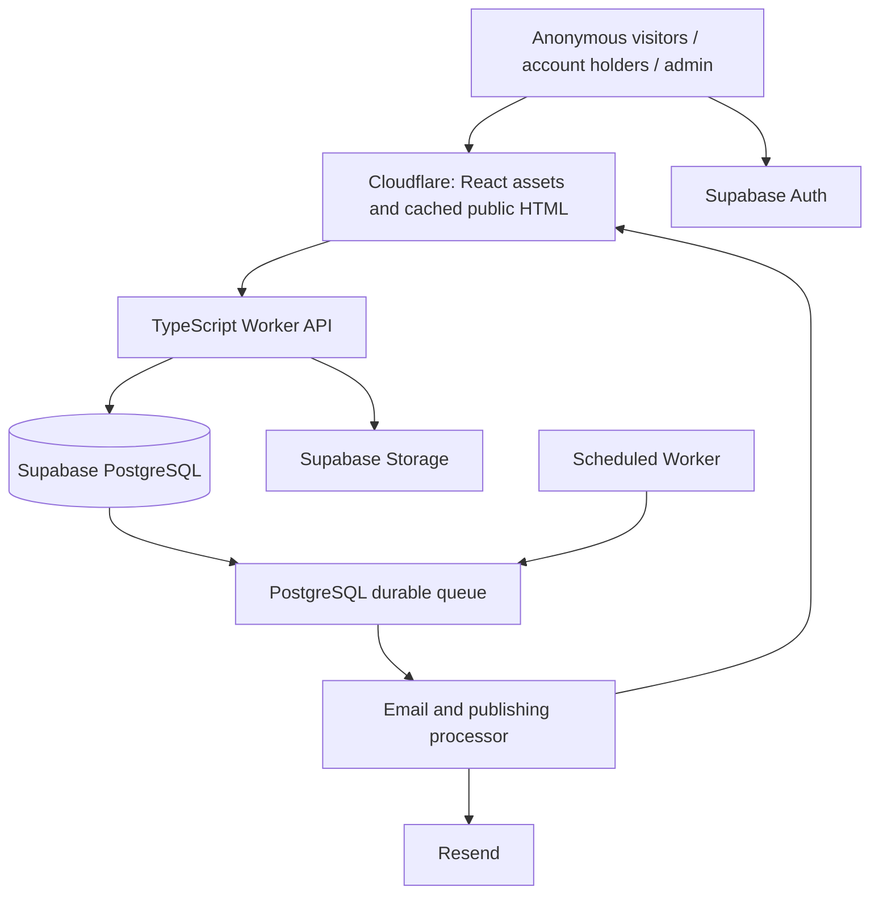

# Portfolio to full-stack application

**Revision notice — October 4, 2026:** The user's Java/Python backend and teaching requirements are addressed in [the full-stack learning guide](full-stack-learning-guide.md) and its Word version. This document remains historical research; its TypeScript Worker backend and $30 service baseline are not the active implementation recommendation. See [AI_MEMORY.md](../AI_MEMORY.md) for current decisions and status.

Research and proposed architecture — October 1, 2026. This is a decision brief, not an approved implementation specification. Prices are USD before tax, checked against linked vendor pages. No infrastructure has been provisioned.

## 1. Outcome and assumptions

You administer all portfolio content through the website. Visitors can create accounts, manage their own information, read published content, access the existing protected résumé, and contact you. Anonymous browsing and contact remain available.

“All fields” means business content: biography, experiences, projects, case studies, skills, services, metrics, social links, contact details, images, résumé, page metadata, and legal page copy. Admins can create, edit, reorder, hide, publish, and archive applicable records. Layout code, credentials, and permissions are not ordinary content fields.

Planning workload: one admin, 1,000 monthly active visitor accounts, 50,000 page views/month, 250,000 dynamic requests/month, 500 inquiries/month, at most 2,000 total transactional emails/month and 100/day, under 1 GB database data, and 2 GB media. These are sizing assumptions, not measured traffic. Target US users initially; validate geography before selecting the database region.

Proposed targets: public content updates visible within 60 seconds, ordinary API p95 below 500 ms from the main audience region, and a 99.9% application availability objective. These require measurement and are not provider guarantees. Initial disaster recovery targets: at most 24 hours of data loss and recovery within four hours, proven by a restore drill. Stricter targets change cost.

## 2. What the repository already has

| Evidence | Architecture implication |
|---|---|
| `package.json`: React 19, Vite, TypeScript, TanStack Query, Zod | Keep the UI and existing form/query tools. |
| `src/data/profile.ts`, `workProjects.ts`, `caseStudies.ts`, `expertise.ts` | Move content to managed records; seed existing facts without rewriting them. |
| `src/auth/Auth0ProviderWithNavigate.tsx` | Existing Auth0 integration needs preservation or a planned migration. |
| `src/components/ProtectedRoute.tsx` | Checks login only; admin authorization must be added at the API/database boundaries. |
| `src/api/UserApi.tsx`, `src/pages/UserProfile.tsx` | Account scaffolding exists. Local `server/index.mjs` has no `/api/user` route, and `AppRoutes.tsx` has no account route. An external API may exist; not verified. |
| `server/resume.mjs` | Real server-side token verification already protects the private PDF. Preserve its access policy. |
| `src/api/ContactApi.tsx` | Web3Forms sends inquiries; a first-party inbox needs database persistence. |
| `scripts/prerender.mjs`, `src/entry-prerender.tsx` | Public HTML is generated at build time. Runtime data alone would leave crawler HTML stale. |
| `.github/workflows/deploy.yml`, `firebase.json` | Hosting deployment exists; this workflow does not deploy the Node API. |

Also reconcile `VITE_API_URL` in deployment with `VITE_API_BASE_URL` in the account client. Deployment configuration is evidence of intended hosting, not proof of live infrastructure. Existing local edits remain untouched.

## 3. Options and recommendation

| Option | Proposed services | Planning monthly cost | Main tradeoff |
|---|---|---:|---|
| Extend Firebase | Hosting, Firebase Auth, Firestore, Functions, Cloud Tasks, file storage | $0–25 at tiny usage; reserve $25–50 | Least hosting change. Document modeling, security rules, and operation-based billing differ from SQL. |
| Managed PostgreSQL — recommended | Cloudflare Workers/assets, Supabase PostgreSQL/Auth/Storage/Queues, Resend | $30 service baseline; reserve $35–50 | Clear relational model and modest operations work. Hosting/auth migration adds one-time effort. |
| AWS learning deployment | CloudFront/S3, API Gateway/Lambda, Cognito, RDS PostgreSQL, SQS, SES, CloudWatch | $60–150 for a small single-region lab; $250–600+ allowance for redundancy/private networking | Broad infrastructure learning; more configuration, maintenance, and cost variables. |

Firebase and AWS totals are engineering allowances, not vendor quotes or equivalent availability configurations. Exact bills require region, request sizes, data transfer, authentication factors, database instance, and recovery requirements. Firebase has product-specific no-cost quotas and metered paid usage; see [Firebase pricing](https://firebase.google.com/pricing). AWS bills its components separately; see [RDS](https://aws.amazon.com/rds/postgresql/pricing/), [Lambda](https://aws.amazon.com/lambda/pricing/), and [API Gateway](https://aws.amazon.com/api-gateway/pricing/).

The recommendation optimizes this project's features, relational learning, and operating effort. It does not establish a universal “most trusted” provider ranking. Evaluate trust through recovery evidence, support terms, security controls, incident history, and portability.

Start with one application divided into content, identity, inquiries, and publishing modules. Keep business logic separate from provider adapters. Reconsider service separation when independent scaling or team ownership makes it useful.

## 4. Recommended architecture

- **Frontend:** keep React, TypeScript, Vite, React Router, TanStack Query, React Hook Form, and Zod. Add `/account` and `/admin` workflows.
- **API:** a TypeScript Cloudflare Worker with REST endpoints and shared validation. Use Supabase's HTTP API and narrow database functions; avoid an unbounded database connection per edge request.
- **Database:** PostgreSQL with versioned SQL migrations, constraints, indexes, and row-level security (RLS), which restricts which rows each identity can access.
- **Authentication:** target Supabase Auth with verified email, account recovery, and required TOTP MFA for admin writes. Check the verified session and server-owned admin membership on every write. Public registration creates viewers only.
- **Files:** separate public portfolio images from private résumé/draft files. Proxy protected résumé access with `private, no-store`, preserving current behavior. Validate upload types and sizes; serve active content safely.
- **Caching:** browser query cache for UI state; edge cache for published HTML and public API responses. Use a maximum 60-second freshness interval and versioned image URLs. Invalidate on publish, with expiry as a fallback. Never shared-cache account, admin, contact, or protected file responses.
- **Queue:** use Supabase Queues, backed by PostgreSQL, for contact notifications and publish work. Scheduled processing avoids a separate broker subscription. Jobs consume database and execution capacity. [Supabase Queues](https://supabase.com/docs/guides/queues)
- **Spam:** validate Turnstile on the server, impose body limits, and rate-limit contact and signup paths. Turnstile has a free plan. [Turnstile plans](https://developers.cloudflare.com/turnstile/plans/)

### Authentication migration decision

Inspect existing Auth0 users, enabled factors, integrations, and actual billing before switching. Supabase supports Auth0 as an external identity provider, so retaining Auth0 is a valid first release. Its currently advertised free plan covers up to 25,000 active users; Essentials starts at $35/month for 500 users and advertises Pro MFA. Do not assume the current tenant includes required admin MFA. [Auth0 pricing](https://auth0.com/pricing), [Supabase Auth0 integration](https://supabase.com/docs/guides/auth/third-party/auth0)

The $30 baseline assumes Supabase Auth. Keeping a paid Auth0 plan adds its charge. If migrating, map stable identities, verify social login and account recovery, plan password resets where necessary, and preserve résumé permissions. Never merge accounts solely because an unverified email matches.

### Publishing and SEO

Adapt the existing server renderer to accept a published content snapshot. The Worker serves cached HTML rendered from that snapshot and the browser receives the same version for hydration. Validate Worker compatibility of the existing animation and rendering dependencies before committing to this approach.

Publishing atomically selects an immutable revision. Preview bypasses public caching. All public reads use the published revision, so draft edits cannot leak through a second endpoint. Rollback selects a previous revision. If runtime rendering needs too much change, build generated HTML asynchronously and show “publishing” until deployment succeeds; document the longer freshness target before selecting that fallback.

## 5. Data and permissions

Core entities:

- `profiles`: identity reference, display name, optional avatar/preferences. Do not collect postal addresses without a product need.
- `admin_memberships`: managed through a privileged setup process; never writable through account editing.
- `site_profile`, `experiences`, `projects`, `case_studies`, `skills`, `services`, `page_content`, `site_settings`.
- `content_revisions`, `published_revisions`, `media_assets`.
- `contact_messages`, `notification_deliveries`, durable queue records.
- `audit_events`: actor, action, entity, revision, timestamp; omit secrets and unnecessary personal data.

Use foreign keys, real dates, display order, publication state, and a version number for concurrent edit detection. Use constrained structured content for page sections, not unrestricted executable HTML.

| Actor | Read | Write |
|---|---|---|
| Anonymous | Published portfolio | Submit contact through validated API |
| Visitor account | Published portfolio, own account, protected résumé | Own permitted account fields; contact |
| Admin with MFA | Drafts, published content, inbox, audit history | All editable site content; publication; own account |

Server derives identity from verified tokens, never from a client-provided user ID. RLS protects account ownership and publication state. Use caller identity for normal database operations. Privileged credentials remain server-only and are limited to operations that need them. Admin status does not grant access to passwords or provider secrets.

Representative API: `GET /api/site`, `GET/PATCH /api/me`, `POST /api/contact`, `GET /api/resume`, and admin content/preview/publish/inbox endpoints. Reject unauthorized calls even when made without the UI.

### Reliable contact delivery

One database transaction stores the inquiry and queues its notification. Return success after durable acceptance, not after email delivery. An idempotency key prevents browser retries from creating duplicate inquiries. Workers claim jobs with a lease, retry with backoff, and move persistent failures to a reviewable failed state. Use provider idempotency plus a delivery ledger; do not promise exactly-once email delivery across failures. Admin sees the saved inquiry even if email is unavailable.

## 6. Cost worksheet

| Component | Monthly baseline | Included allowance or condition |
|---|---:|---|
| Cloudflare Workers Paid | $5 | 10M requests and 30M CPU milliseconds; ordinary static asset requests are free. |
| Supabase Pro | $25 | One Micro project covered by compute credit; 8 GB database, 100 GB files, 250 GB uncached egress. |
| PostgreSQL queue | $0 separate subscription | Uses the same project's resources. |
| Resend Free | $0 | 3,000 emails/month, maximum 100/day; includes authentication mail usage in our budget. |
| Turnstile | $0 | Free plan. |
| **Service baseline** | **$30/month; $360/year** | Within these allowances. |
| Separate paid staging project | +$10 | Optional additional Micro project. Local development otherwise. |
| Resend Pro | +$20 | 50,000 emails/month; useful when daily free limit is insufficient. |

Sources: [Cloudflare Workers pricing](https://developers.cloudflare.com/workers/platform/pricing/), [Supabase pricing](https://supabase.com/pricing), [Resend pricing](https://resend.com/pricing).

Reserve $5–20/month above baseline for independent file backups, domain renewal allocation, monitoring, and modest overages. This reserve is an estimate, not an unlimited allowance. Existing paid subscriptions, mailbox service, taxes, development labor, and migration overlap are excluded. A staged setup with paid email has a $60/month service baseline before that reserve.

At the assumed 250,000 dynamic requests and 5 ms average CPU/request, Worker usage is 1.25M CPU ms. At 50,000 page views and 1 MB/page, delivery is roughly 50 GB; attribute images to their actual storage provider when budgeting. Email authentication bursts may breach the daily allowance even when monthly volume is low.

Workers overage formula: $5 + $0.30 per additional million requests above 10M + $0.02 per additional million CPU ms above 30M. Storage, database compute, and network usage must be budgeted separately. Alerts do not guarantee a hard spending cap.

Growth option: move queue processing to Cloudflare Queues when independent throughput or database isolation warrants it. Paid Workers includes 1M queue operations/month; additional operations cost $0.40/M. A small message normally takes three operations, and retries add more. [Queues pricing](https://developers.cloudflare.com/queues/platform/pricing/)

## 7. Production quality and enterprise growth

All requested application features fit the recommended design. Availability contracts, recovery guarantees, private networking, and enterprise support are separate requirements with separate costs.

- **Recovery:** daily database backups plus independent media copies and a verified restore procedure. Supabase database backups exclude stored file objects. [Backup documentation](https://supabase.com/docs/guides/platform/backups)
- **Operations:** structured logs with request IDs; monitor error rate, latency, queue age, failed jobs, login failures, database usage, and spending. Alert before limits affect users.
- **Delivery:** preview/staging checks, lint/build, authorization tests, migrations, browser flows, and rollback. Extend existing CI to run relevant tests before production release.
- **Security:** default deny, admin MFA, request validation, private files, safe rendering, dependency maintenance, account export/deletion, and a defined inquiry retention period.
- **Performance:** measure slow queries, indexes, pagination, and cache hit rate before increasing database compute or adding Redis.
- **Scale:** introduce dedicated queues, larger database compute, replicas for eligible reads, and service extraction only after observed constraints justify them.
- **Enterprise:** define tenants and isolation if this becomes SaaS; evaluate SSO/SCIM, immutable audit retention, contractual SLAs, regional recovery, and regulatory requirements. Reprice those separately.

Redis becomes useful for frequently reused expensive computations or shared transient state when edge caching cannot meet the measured need. PostgreSQL remains the source of truth. Cache failure should degrade performance without corrupting durable data.

## 8. Delivery roadmap and learning curriculum

Each phase ends with evidence you can explain as an architect.

| Phase | Build / study | Proof |
|---|---|---|
| 1. Requirements | Roles, editable-field inventory, traffic, budget, recovery targets | Permission matrix, system context diagram, and one-page architecture decision record |
| 2. Data and identity | Schema, migrations, seeded content, account lifecycle, admin MFA | Visitor cannot edit content or another account; recovery and résumé flows pass |
| 3. Admin CMS | Validated editing, images, ordering, draft preview, publication, rollback | Every agreed content field edits without a code deployment; drafts stay private |
| 4. Public delivery | Published snapshot, HTML rendering, cache expiry/invalidation | Browser and crawler see matching published revision within target time |
| 5. Contact reliability | Inbox, transactional queue, email processor, spam controls | Email outage loses no accepted inquiries; retries do not duplicate records |
| 6. Operations | CI/CD, dashboards, backups, restore and load exercises | Timed restore, measured latency, actual bill compared with forecast |
| 7. Enterprise laboratory | Port an isolated module to AWS; model SQS, RDS, IAM, infrastructure as code | Explain portability costs, failure boundaries, and when migration is worthwhile |

For every decision, write: **requirement → options → tradeoff → decision → measured evidence → revisit trigger**.

Practice questions:

1. Why does hiding an Edit button not enforce authorization?
2. What happens if the database saves a message and the email provider fails?
3. How can cached HTML accidentally expose a draft?
4. What data survives restoring yesterday's database but not yesterday's files?
5. Which metric justifies buying a larger database or adding Redis?
6. What extra cost buys a recovery guarantee your business actually needs?

Architecture skill grows through answering these with tested systems. Latest technology is useful when it improves a requirement, cost, or operational outcome.

## 9. Decisions for the next design review

Visitor accounts are confirmed. Remaining design choices: monthly budget ceiling; whether to retain existing Auth0 users; final editable-field inventory; signup methods; acceptable recovery/freshness targets; primary user geography. The assumptions above allow a concrete recommendation now. Resolve these before turning the proposal into an implementation specification.
